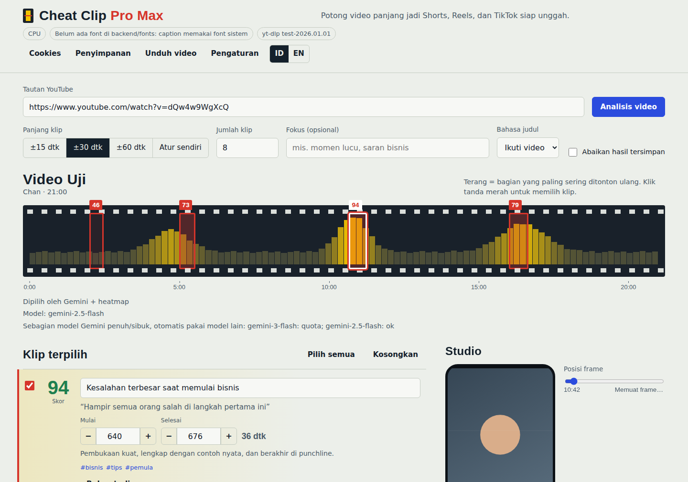

# Cheat Clip Pro Max

Potong video YouTube panjang jadi klip vertikal 9:16 siap unggah: analisis AI + heatmap retensi penonton, face tracking yang halus, caption karaoke per kata, render batch dengan GPU.



<sub>Tangkapan layar memakai data demo (yt-dlp dan Gemini disimulasikan oleh harness uji), bukan video sungguhan. Lihat juga `docs/screenshots/` untuk studio, antrean, dan mobile.</sub>

> Ini penulisan ulang dari [`galihjuansaputra/cheat-clip-pro`](https://github.com/galihjuansaputra/cheat-clip-pro) berdasarkan README-nya.
> Source backend/frontend repo asli tidak bisa dibaca saat analisis, jadi tidak ada kode yang disalin. Detail temuan, perbedaan, dan batas verifikasi ada di [`docs/ANALYSIS.md`](docs/ANALYSIS.md).

## Mulai cepat

Butuh Python 3.10+ dan [ffmpeg](https://ffmpeg.org/download.html) di `PATH`. **Tidak perlu Node.js** (UI tanpa build).

| Sistem | Cara |
|---|---|
| **Windows** | Klik dua kali **`run.bat`**. Pertama kali ia menyiapkan `.venv` dan memasang dependensi (butuh internet), setelah itu langsung jalan. |
| **macOS / Linux** | `./run.sh` (perilakunya sama). |
| Manual | `python -m pip install -r requirements.txt` lalu `python run.py` |

Browser terbuka di `http://127.0.0.1:8000`. Lalu:

1. Buka **Pengaturan**, tempel API key Gemini gratis dari [aistudio.google.com](https://aistudio.google.com/). Tanpa key pun jalan: klip dipilih dari heatmap. Ketik `mock` untuk mode demo.
2. Tempel tautan YouTube → **Analisis video**.
3. Klik tanda merah di strip film atau **Buka studio** untuk mengatur tampilan, centang klip, **Render**.

### Khusus Windows

- Pasang ffmpeg sekali: `winget install Gyan.FFmpeg`, lalu **tutup dan buka lagi** jendela terminal/`run.bat` agar `PATH` terbaca.
- Pasang Python dari python.org dan centang **Add python.exe to PATH**.
- Firewall mungkin menanyakan izin saat pertama jalan. Server hanya melayani komputermu sendiri, jadi aman memilih batal.
- Bila `run.bat` gagal memasang dependensi, hapus folder `.venv` lalu coba lagi. Untuk memasang ulang dependensi setelah `requirements.txt` berubah, hapus file `.venv\.deps_ok`.
- Pembatalan memakai `taskkill /T /F` agar ffmpeg anak ikut berhenti. Jalur ini belum pernah dijalankan di Windows oleh penyusunnya; CI GitHub (job `windows-latest`) disiapkan untuk menguji hal ini.
- Izin file `cookies.txt` (`chmod 600`) tidak berlaku di Windows; jaga folder `data\` seperti menjaga password.

Font caption: taruh file `.ttf` statis di `backend/fonts/` (lihat `README.txt` di sana). Tanpa itu ffmpeg memakai font sistem.

### Face tracking lebih akurat: model YuNet (disarankan, opsional)

Tanpa model, face tracking memakai Haar cascade bawaan OpenCV: tanpa unduhan, tetapi lemah pada wajah menyamping atau terhalang. Dengan YuNet (detektor CNN kecil dari [opencv_zoo](https://github.com/opencv/opencv_zoo/tree/main/models/face_detection_yunet), lisensi MIT) deteksi jauh lebih stabil:

```bash
python -m backend.models          # unduh ~230 KB ke data/models, diverifikasi SHA-256 dan ukuran
```

Setelah terpasang, `FACE_DETECTOR=auto` (default) otomatis memakainya. Bila model hilang atau rusak, render tetap jalan dengan Haar dan memberi catatan. Perintahnya aman dijalankan berulang: file yang sudah benar tidak diunduh lagi, dan unduhan yang hash-nya tidak cocok tidak pernah dipasang. Tanpa internet, taruh sendiri `face_detection_yunet_2023mar.onnx` di `data/models/` atau tunjuk lewat `YUNET_MODEL`.

## Yang berbeda dari versi PRO

| Area | Pro Max |
|---|---|
| Face tracking | Detektor YuNet (opsional) atau Haar, median filter, deadzone, batas kecepatan pan, dan *jump-cut* di pergantian adegan yang sungguh terdeteksi (filter `scene` ffmpeg). Hasil dipadatkan jadi beberapa keyframe (bukan gerak kamera bergetar). |
| Pemilihan klip | Skor AI digabung dengan retensi penonton, lalu dipotong di batas kalimat dan dibuang bila tumpang-tindih. Video 2–3 jam dipecah per jendela waktu. Tanpa AI tetap menghasilkan klip dari heatmap. |
| Model Gemini | Daftar model diambil dari akunmu (bukan daftar tetap yang bisa basi), fallback otomatis saat kuota habis / model sibuk. |
| Render | Antrean persisten (SQLite), progres real-time dari ffmpeg, bisa dibatalkan dan diulang, encoder GPU hanya dipakai bila *test-encode* nyata berhasil, jatuh ke CPU otomatis bila gagal di tengah. |
| Caption | 10 gaya, kata aktif disorot dan "pop", baris dipecah otomatis, tag `[MUSIC]`/`(applause)` dibuang, opsi simpan `.srt`. |
| Layout | Ikuti wajah, tengah, letterbox (blur/hitam; 16:9, 4:3, 1:1), split streamer, kamera mengambang, dan **dua pembicara** (dua panel ditumpuk, masing-masing mengikuti satu wajah, caption di sambungan; otomatis kembali ke Ikuti wajah bila dua wajah tak stabil terlihat bersamaan). Preview 9:16 memakai rumus crop yang sama dengan renderer. |
| Hasil | ZIP + **paket publikasi** (`.csv`: judul, hook, hashtag, waktu, **kanal dan tautan video sumber**) dan tombol salin caption. Kanal YouTube sumber juga tampil di header video dan kartu antrean. |
| Keamanan | Lihat bawah. |
| UI | Strip film heatmap, studio, ID/EN, mobile, mode gelap. |

## Konfigurasi

Salin `.env.example` ke `.env`. Semua opsional.

| Variabel | Fungsi |
|---|---|
| `APP_TOKEN` | **Wajib** bila `HOST` bukan `127.0.0.1`. `run.py` menolak start tanpanya. |
| `ALLOWED_HOSTS` | Host video yang boleh diproses. Default hanya YouTube. |
| `RENDER_WORKERS` | Render paralel (default 2). |
| `GEMINI_MODELS` | Paksa urutan model; kosong = otomatis. |
| `DATA_DIR` | Database, cache, hasil render, cookies (default `./data`). |
| `YTDLP_PROXY`, `FFMPEG_BIN` | Proksi / lokasi ffmpeg khusus. |
| `FACE_DETECTOR` | `auto` (default: YuNet bila modelnya terpasang, selain itu Haar), `yunet`, atau `haar`. |
| `YUNET_MODEL` | Path file `.onnx` YuNet bila tidak di `DATA_DIR/models`. |
| `WHISPER_MODEL`, `WHISPER_DEVICE` | Transkrip lokal (`pip install faster-whisper`) bila video tak punya subtitle. |

## Keamanan

- Server hanya mendengarkan `127.0.0.1` secara default. Permintaan dengan header `Host` asing (DNS rebinding) dan `POST` dari `Origin` lain (CSRF dari situs yang kamu buka) ditolak.
- API key Gemini dikirim lewat header `X-Gemini-Key` dan hanya hidup di memori selama job berjalan. Tidak masuk URL, log, atau database (dibuktikan oleh test).
- Hanya host di allowlist yang diterima; `file://` dan alamat internal ditolak. Nama file diunduh divalidasi (anti path-traversal). Subprocess tidak pernah memakai shell.
- Cookies disimpan `chmod 600`; API hanya mengembalikan jumlah dan domain, tidak pernah nilainya.
- `APP_TOKEN` membuat semua endpoint memerlukan cookie `httpOnly` / `SameSite=Strict`.

## Docker

```bash
echo "APP_TOKEN=$(python -c 'import secrets;print(secrets.token_urlsafe(24))')" > .env
docker compose up --build
```

Port hanya dipublikasikan ke `127.0.0.1`. Untuk NVENC lihat komentar di `docker-compose.yml`.

## API

Endpoint yang sama dengan versi PRO tetap ada (`/api/health`, `/api/analyze`, `/api/render-batch`, `/api/render-progress/{id}`, `/api/download-rendered/{file}`, `/api/download-batch-zip/{id}`, `/api/clip-frame`, `/api/cookies`, `/api/download-raw-video`, `/api/download-raw-status/{id}`, `/api/temp-storage-info`, `/api/clear-temp`). Perbedaan yang memutus kompatibilitas:

| Endpoint | Perubahan |
|---|---|
| `GET /api/models` | API key lewat header `X-Gemini-Key`, **bukan** `?api_key=`. |
| `POST /api/analyze` | Mengembalikan `{job_id}`; ikuti lewat `GET /api/jobs/{id}/events` (SSE) atau poll `GET /api/jobs/{id}`. Hasil dicache 24 jam. |
| `POST /api/render-batch` | Mengembalikan `{batch_id, job_ids}`; progres lewat `GET /api/batches/{id}/events` (SSE) atau `render-progress`. |

Baru: `/api/presets`, `/api/jobs/{id}/cancel|retry`, `/api/batches/{id}/cancel`, `/api/publish-pack/{id}`, `/api/auth-status`, `/api/login`, `/api/system/update-ytdlp`. Dokumentasi interaktif di `/docs`.

## Pengembangan & test

```bash
python -m pip install -r requirements-dev.txt
python -m unittest discover -s tests -t .      # backend + kontrak UI↔API
node --test tests/frontend.test.mjs            # logika frontend, i18n
python -m tests.e2e.run_ui                     # UI di Chromium (pip install playwright && playwright install chromium)
```

Status yang diverifikasi saat penyusunan: **217 test Python** (23 dilewati di lingkungan penyusunan: 15 test handler yang hanya jalan dengan stub FastAPI, dijalankan terpisah dan lulus, serta 8 yang butuh OpenCV 4.x dengan Haar), **27 test Node**, dan skrip UI E2E di Chromium (alur lengkap analisis → studio → render → unduh, layout *Dua pembicara*, kredit kanal, ID/EN, mobile, nol error konsol). Render memakai ffmpeg sungguhan, dan face tracking diuji dengan YuNet asli pada video sintetis. `tests/test_http.py` dijalankan dengan FastAPI asli (6 test).

**Belum diverifikasi** (tidak ada internet/GPU di lingkungan penyusunan): unduhan YouTube sungguhan lewat yt-dlp, panggilan Gemini sungguhan, unduhan model YuNet dari GitHub (pengunduh hanya diuji dengan jaringan palsu), encoder NVENC, akurasi deteksi wajah pada footage wawancara nyata (hanya video sintetis), jalur Haar pada OpenCV 4.x, dan Windows.

## Troubleshooting

- **"YouTube meminta verifikasi bot"** → menu **Cookies**, tempel `cookies.txt` format Netscape.
- **Unduhan gagal / "format tidak tersedia"** → `pip install -U yt-dlp`. Versi terbaru yt-dlp kadang meminta runtime JavaScript (mis. Deno); lihat dokumentasi yt-dlp.
- **Kuota Gemini habis (429)** → otomatis pindah model; bila semua penuh, klip dipilih dari heatmap dan diberi catatan.
- **GPU tidak terpakai** → lihat chip di header. GPU hanya dipakai bila test-encode berhasil; pilih encoder manual di Studio → Hasil akhir.
- **Caption terlihat beda dari preview** → pasang font di `backend/fonts/`; preview di browser hanya perkiraan.

## Struktur

```
run.bat / run.sh        peluncur sekali klik (venv + dependensi)
run.py                  launcher (cek ffmpeg & dependensi, pengaman bind jaringan)
backend/
  main.py               endpoint HTTP, auth, guard Host/Origin
  pipeline.py           alur analisis & render
  render.py             probe → face track → ASS → ffmpeg (progres, batal, fallback)
  facetrack.py          detektor (YuNet/Haar) + smoothing + ekspresi crop
  scenes.py             deteksi pergantian adegan (filter scene ffmpeg)
  models.py             pengunduh model opsional ber-checksum (python -m backend.models)
  layouts.py            filtergraph ffmpeg per layout
  captions.py           sanitasi, chunking, generator ASS
  clips.py              fusi skor, snapping, NMS, heuristik
  gemini.py             klien REST, discovery model, fallback, windowing
  procutil.py           subprocess per-grup + kill_tree (pembatalan sampai ke ffmpeg anak)
  ytdlp.py transcript.py hwenc.py jobs.py db.py security.py config.py
frontend/               UI tanpa build (ES modules)
tests/                  unit, integrasi, kontrak, E2E
docs/ANALYSIS.md        analisis repo asli, keputusan desain, batas verifikasi
docs/REFERENCES.md      proyek serupa yang dipelajari: apa yang diadopsi, apa yang tidak, lisensi, sumber
```

## Catatan hukum

Gunakan hanya untuk video milikmu atau yang kamu punya izin memotong dan mengunggah ulang. Patuhi Ketentuan Layanan YouTube dan hukum hak cipta di wilayahmu; mengunduh konten pihak lain bisa melanggar keduanya. Penulis tidak bertanggung jawab atas penggunaan alat ini.

## Lisensi

MIT. Lihat `LICENSE`.
